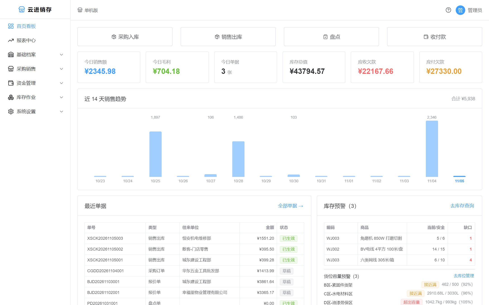
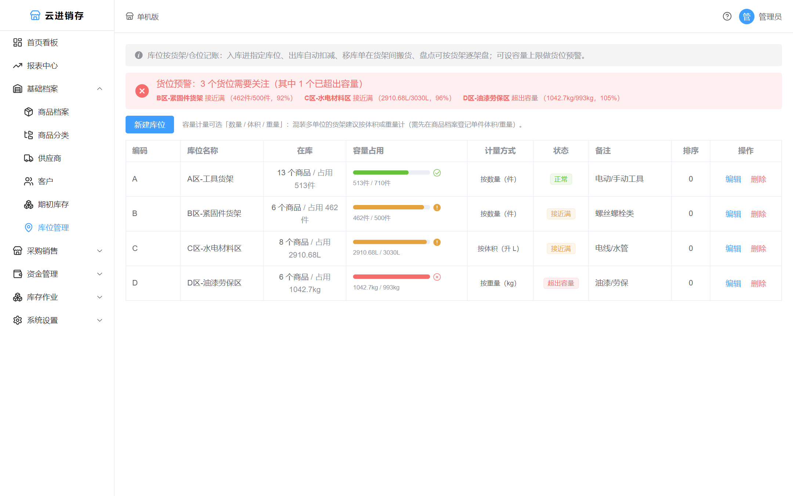
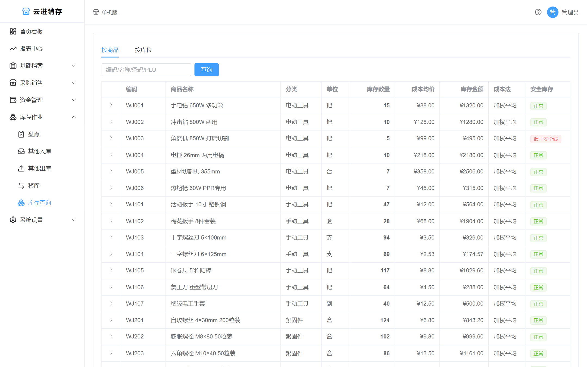
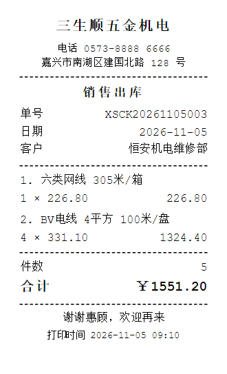
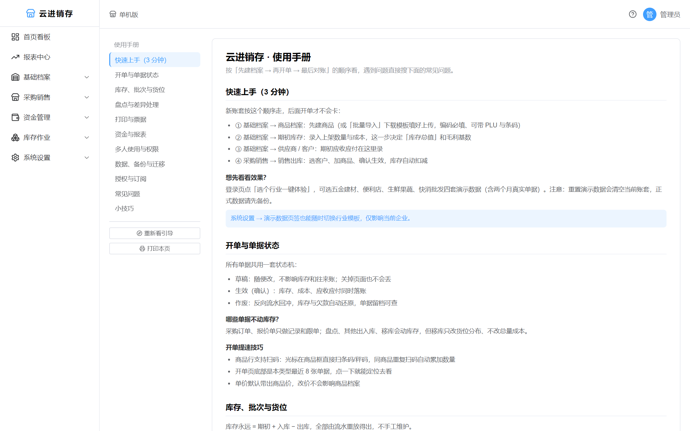
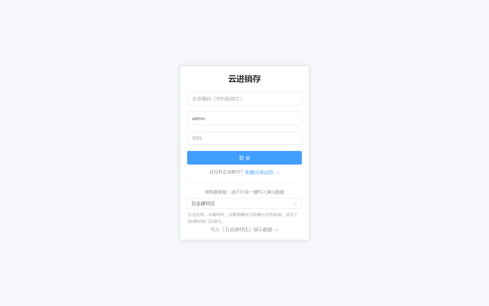

# 云进销存 JXC

[](LICENSE)
[](server/go.mod)
[](web/package.json)
[](build.sh)
[](CONTRIBUTING.md)

面向**单店/单仓小微商户**（五金建材、便利店、生鲜果蔬、快消批发）的进销存系统：采购销售、库存成本、批次保质期、货架库位、盘点差异、收付款与报表，一个二进制文件跑起来，数据落在本地 SQLite。

> An open-source inventory management system for small merchants — purchasing, sales, stock costing, batch expiry, bin locations, stocktake, finance and reporting. Single binary, embedded Vue frontend, SQLite storage, works offline.



## 为什么会有这个项目

市面上的进销存要么是重量级 ERP（实施三个月），要么是云端 SaaS（数据不在自己手里、断网就停业）。小商户真正需要的是：**一台电脑、一个文件、双击就能开单，数据能自己拷走**。

所以这里的技术选择都很"土"：SQLite 而不是 MySQL，`go:embed` 而不是 Nginx 托管前端，单文件而不是容器编排。代价是不能横向扩展，收益是门店老板自己就能部署和迁移。

## 功能

| 模块 | 能力 |
|---|---|
| 基础档案 | 商品分类、商品（多价位/成本方式/批次开关/默认库位/PLU 码）、供应商与客户（期初应收应付）、期初库存、Excel 批量导入（带模板下载） |
| 采购销售 | 采购订单、采购入库/退货、销售出库/退货、报价单、其他出入库、单据查询；统一单号、草稿→生效→作废状态机，作废自动回冲库存 |
| 库存引擎 | 移动加权平均 / FIFO（按商品选择，FIFO 强制批次），负库存开关，库存流水只追加、可逐笔对账 |
| 货架库位 | 商品×库位数量账；出库按默认库位优先扣减，移库单在货架间搬货；库位级禁负库存；容量按**数量/体积/重量**三种方式计量，超额与接近满预警（可选拦截） |
| 盘点 | 全仓盘 / 逐架盘（差额就地调整该货架）；留账面快照，差异表可打印、导出 CSV；差异率或金额超阈值需主管审批才调账；支持按差异项复盘生成关联新单 |
| 资金 | 应收应付实时聚合、收款单/付款单、作废回滚 |
| 报表 | 首页看板（6 指标 + 14 天趋势 + 最近单据 + 低库存与货位预警）、进销存汇总、销售毛利明细 |
| 秤码 | 电子秤标签扫码开单：内置顶尖 LS 13 位（金额码/重量码）、大华寺冈 18 位规则，其他品牌加规则即可 |
| 打印 | A4 单据（明细 + 大写金额 + 签收栏）与 58mm 热敏小票；Logo、抬头、字段显隐可配，关掉金额就是送货单 |
| 系统 | 四层 RBAC（菜单/路由/接口/单据）、用户角色、操作日志、每日自动备份 + 手动下载、演示数据一键重置 |
| 产品化 | 单文件部署、Ed25519 机器码授权（30 天试用、过期只读）、Caddy 反代 HTTPS、Windows 服务开机自启（原生 `-install`） |
| 多租户（可选） | 企业注册开户 + 订阅计费、JWT 携带租户、全表自动隔离、按套餐限制用户数；不启用时就是单机版 |

| 库位容量与预警 | 库存查询 |
|:---:|:---:|
|  |  |

| 58mm 小票 | 内置使用手册 |
|:---:|:---:|
|  |  |

## 快速开始

### 方式一：源码运行（开发）

```bash
# 后端 :8080，首次启动自动建库、建表并创建管理员
cd server && go run ./cmd

# 前端 :5173，/api 代理到 8080，改动热更新
cd web && npm install && npm run dev
```

打开 <http://localhost:5173>，账号 `admin / admin123`（登录后请立即改密）。

登录页的「选个行业一键体验」可以载入 **五金建材 / 便利店 / 生鲜果蔬 / 快消批发** 四套演示数据，各含近两个月的自洽单据（库存、成本、应收应付、报表全部对得上），不用手工建档就能把流程点一遍。



### 方式二：构建单文件

```bash
# Linux / macOS
bash build.sh
# Windows
build.bat
```

产物 `release/jxc.exe`（约 20–30 MB，已内嵌全部前端页面）。放到任意空目录双击运行，浏览器访问 <http://localhost:8080>。**换机迁移 = 拷贝整个目录**，数据在 `data/`。

### 方式三：Docker

```bash
docker compose up -d          # 数据卷 jxc-data，仅监听 127.0.0.1:8080
# 或
docker build -t jxc . && docker run -d -p 8080:8080 -v jxc-data:/app/data jxc
```

### 环境变量

| 变量 | 默认值 | 说明 |
|---|---|---|
| `JXC_PORT` | `8080` | 监听端口 |
| `JXC_DB_PATH` | `data/jxc.db` | SQLite 文件路径 |
| `JXC_JWT_SECRET` | 自动生成 | 留空则在数据目录生成 `.jwt_secret`（0600）并复用；多实例必须显式设置同一个值 |
| `JXC_TRUSTED_PROXIES` | `127.0.0.1,::1` | 信任的反向代理地址（IP/CIDR，逗号分隔），`none` = 不信任任何代理 |
| `JXC_HOME` | exe 所在目录 | Windows 服务模式下的数据根目录 |

## 部署

**Windows 开机自启**（管理员 CMD，exe 所在目录）：

```bat
jxc.exe -install     :: 注册服务并启动（幂等，升级后重跑即可）
jxc.exe -status      :: 运行状态 / 程序路径 / 启动类型
jxc.exe -uninstall   :: 停止并卸载，data 目录保留
```

服务名 `JXC`，崩溃按 5s→10s→30s 自动重启，日志写 `data/logs/jxc-YYYY-MM-DD.log`（保留 14 天）。服务方式下 Windows 给的工作目录是 `System32`，程序会自动切回 exe 目录，数据不会跑丢。

**公网 / HTTPS**：不要直接暴露 8080。用 Caddy 终结 TLS，应用只监听回环：

```
浏览器 ──HTTPS(443)──▶ Caddy ──HTTP(127.0.0.1:8080)──▶ jxc
```

改一行域名即可自动申请续期证书，配置见 [`deploy/Caddyfile`](deploy/Caddyfile)；Linux systemd 单元见 [`deploy/jxc.service`](deploy/jxc.service)。详细步骤（含内网自签、常见故障排查）见 [用户手册](docs/用户手册.md)。

**数据安全**：每天首次启动自动 `VACUUM INTO` 备份到 `data/backups/`；登录与所有数据变更写操作日志（密码脱敏）。公网部署前请务必修改默认密码、设置 `JXC_JWT_SECRET`，并阅读 [SECURITY.md](SECURITY.md)。

## 架构

```
JXC/
├── server/                     Go + Gin + GORM
│   ├── cmd/main.go             入口：前台/Windows 服务双模式、路由装配
│   ├── cmd/genlicense          授权签发（私钥从环境变量读）
│   ├── cmd/genkey              生成 Ed25519 密钥对
│   └── internal/
│       ├── model/              GORM 模型 + 迁移 + 租户插件接入
│       ├── repo/               数据访问（只做 CRUD）
│       ├── service/            ★ 业务规则：库存/成本/单据状态机全在这里
│       ├── api/                HTTP 薄层：绑定参数 → 调 service → 统一响应
│       ├── middleware/         JWT、租户隔离、授权、审计、安全响应头
│       ├── platform/winsvc/    Windows 服务封装（含非 Windows 占位）
│       ├── pkg/                错误码、单号、金额、日志、授权算法
│       └── webembed/           go:embed 内嵌前端产物
├── web/                        Vue 3 + TS + Vite + Element Plus + Pinia
├── deploy/                     Caddyfile、systemd 单元
└── docs/                       PRD / 数据模型 / API / 开发约定 / 用户手册 / 变更日志
```

几条贯穿全局的约定：**业务规则只写 service 层**；金额一律 `int`（分）、数量 `int64`（实际值×1000）；库存流水只追加不可改；每次写操作在事务内完成。细节见 [CONVENTIONS.md](docs/CONVENTIONS.md)，表结构见 [DATA-MODEL.md](docs/DATA-MODEL.md)。

## 产品授权（可选）

项目内置一套 Ed25519 机器码授权，用于把软件作为商品售卖：未授权时全功能试用 30 天，授权过期后只读、导入新授权即恢复。

开源不改变这一点，但**密钥由你自己掌握**：

```bash
# 1. 生成密钥对
cd server && go run ./cmd/genkey
#    PUBLIC_KEY  → 填入 internal/pkg/license/license.go
#    PRIVATE_KEY → 只保存在自己手里

# 2. 签发（私钥经环境变量传入，不落代码）
export JXC_LICENSE_KEY='<PRIVATE_KEY>'
go run ./cmd/genlicense -owner "某某商贸" -days 365 -code XXXX-XXXX-XXXX-XXXX -out license.key
```

客户在「系统设置 → 授权信息」导入 `license.key` 即时生效。如果你只是自用或二次开发，完全可以把授权校验去掉——MIT 允许。

## 文档

- [用户手册](docs/用户手册.md) —— 面向店员的 11 个场景 + 常见问题，可打印
- [PRD](docs/PRD.md) · [数据模型](docs/DATA-MODEL.md) · [API](docs/API.md) · [开发约定](docs/CONVENTIONS.md)
- [变更日志](docs/CHANGELOG.md) · [路线图与待办](docs/TODO.md)
- 系统内 `/help` 有同源的使用手册页，首次登录会自动播放新手引导

## 参与贡献

欢迎 issue 与 PR。开始之前请看 [CONTRIBUTING.md](CONTRIBUTING.md)：环境要求、提交前自检命令、代码约定，以及**不要提交 `data/`、`*.db`、`license.key`**。

安全问题请私下报告（[SECURITY.md](SECURITY.md)），不要开公开 issue。

## 许可证

[MIT](LICENSE)。可自由使用、修改、分发与商用，请保留版权声明。

> 免责声明：本系统按现状提供，不构成任何账务或税务建议。进销存数据直接影响库存与往来账，上线前请用真实业务试算并与手工账核对，定期备份 `data/` 目录。
